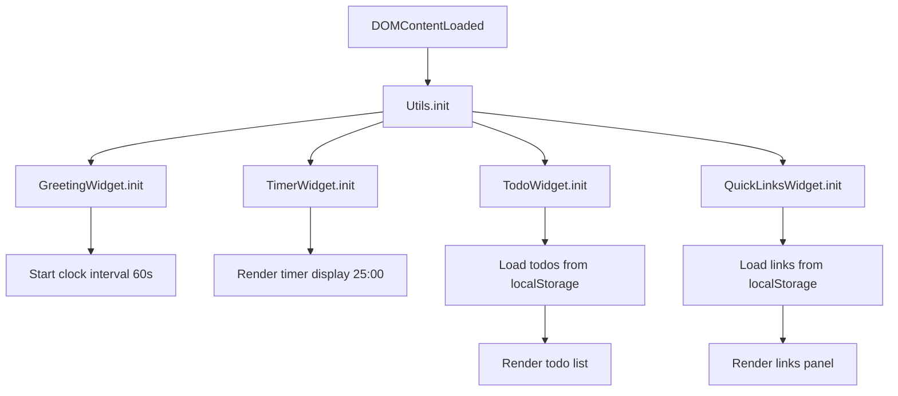

# Design Document

## Overview

To-Do List Life Dashboard adalah sebuah halaman web produktivitas pribadi yang berjalan sepenuhnya di sisi klien (client-side only). Tidak ada server, tidak ada framework — hanya HTML, CSS, dan Vanilla JavaScript murni.

Dashboard ini menyatukan empat widget dalam satu antarmuka:

1. **Greeting Widget** — Waktu, tanggal, dan sapaan kontekstual dalam bahasa Indonesia
2. **Focus Timer** — Countdown 25 menit bergaya Pomodoro dengan state machine yang jelas
3. **To-Do List** — Manajemen tugas lengkap dengan add/edit/complete/delete dan persistensi
4. **Quick Links** — Koleksi tautan favorit yang dapat dikustomisasi

Semua data persisten disimpan di `localStorage` browser. Aplikasi tidak memerlukan koneksi internet setelah file diunduh/dibuka.

### Design Decisions

- **Vanilla JS murni**: Menghindari ketergantungan eksternal agar aplikasi tetap ringan, portable, dan tidak memerlukan build tools. Trade-off: lebih verbose, tapi sesuai constraint Requirement 10.
- **Single-file architecture per concern**: Satu `index.html`, satu `css/style.css`, satu `js/app.js` — memudahkan deployment dan review.
- **Module pattern via IIFE/namespace object**: Tanpa framework, kode diorganisir menggunakan module pattern agar terhindar dari polusi global namespace.
- **Satu `localStorage` key per fitur**: `todos` dan `quicklinks` disimpan sebagai JSON string terpisah, bukan satu blob besar, agar tiap fitur dapat read/write secara independen.

---

## Architecture

### Struktur File

```
project-root/
├── index.html          # Satu-satunya HTML file; mendefinisikan semua markup widget
├── css/
│   └── style.css       # Semua styling; menggunakan CSS custom properties untuk theming
└── js/
    └── app.js          # Semua logika aplikasi; diorganisir per modul/namespace
```

### Arsitektur Kode (`app.js`)

Kode diorganisir menggunakan **namespace object pattern** — setiap widget memiliki namespace-nya sendiri di dalam satu file JS. Ini memberikan separation of concerns tanpa memerlukan module bundler.

```
App (namespace root)
├── Utils            — helper functions (localStorage read/write, DOM query shortcuts)
├── GreetingWidget   — logika waktu, tanggal, dan greeting
├── TimerWidget      — state machine countdown Pomodoro
├── TodoWidget       — CRUD tasks + persistensi
└── QuickLinksWidget — CRUD links + persistensi
```

### Alur Inisialisasi



### Event-Driven Communication

Tiap widget bersifat **self-contained**: mereka hanya membaca dari DOM dan `localStorage`, dan hanya memodifikasi elemen DOM yang berada dalam scope-nya. Tidak ada event bus atau global state — setiap widget mengelola state-nya sendiri.

---

## Components and Interfaces

### 1. Utils Module

Menyediakan helper yang digunakan oleh semua widget.

```javascript
Utils = {
  // Baca dari localStorage, kembalikan parsed value atau defaultValue jika error
  loadFromStorage(key: string, defaultValue: any): any,

  // Tulis ke localStorage sebagai JSON string
  saveToStorage(key: string, value: any): void,

  // Query selector shorthand
  qs(selector: string, scope?: Element): Element | null,
  qsAll(selector: string, scope?: Element): NodeList,

  // Escape HTML untuk mencegah XSS saat merender teks user
  escapeHtml(text: string): string,
}
```

### 2. GreetingWidget

```javascript
GreetingWidget = {
  init(): void,          // Jalankan render pertama, set interval 60 detik
  render(): void,        // Update DOM: waktu, tanggal, greeting
  getTimePeriod(hour: number): 'pagi' | 'siang' | 'sore' | 'malam',
  formatTime(date: Date): string,   // "HH:MM"
  formatDate(date: Date): string,   // "Minggu, 7 November 2026"
}
```

**DOM Elements:**
- `#greeting-text` — "Selamat Pagi / Siang / Sore / Malam"
- `#clock-display` — "HH:MM"
- `#date-display` — tanggal dalam format Indonesia

### 3. TimerWidget

Timer diimplementasikan sebagai **state machine eksplisit** dengan empat state:

```
        [IDLE/RESET]
             │ start()
             ▼
         [RUNNING] ──── stop() ────► [PAUSED]
             │                           │
             │ (countdown = 0)           │ start()
             ▼                           │
         [FINISHED] ◄───────────────────┘
             │
             │ reset()
             ▼
        [IDLE/RESET]
```

```javascript
TimerWidget = {
  state: 'idle',          // 'idle' | 'running' | 'paused' | 'finished'
  remaining: 1500,        // detik tersisa (1500 = 25 menit)
  intervalId: null,

  init(): void,
  start(): void,          // idle/paused → running
  stop(): void,           // running → paused
  reset(): void,          // any → idle, remaining = 1500
  tick(): void,           // dipanggil tiap detik, kurangi remaining
  onFinish(): void,       // running → finished, tampilkan pesan selesai
  render(): void,         // update DOM sesuai state saat ini
  formatTime(seconds: number): string,  // "MM:SS"
  updateControls(): void, // enable/disable tombol sesuai state
}
```

**DOM Elements:**
- `#timer-display` — "MM:SS"
- `#timer-start-btn` — tombol Start
- `#timer-stop-btn` — tombol Stop
- `#timer-reset-btn` — tombol Reset
- `#timer-message` — pesan selesai (hidden kecuali state = finished)

### 4. TodoWidget

```javascript
TodoWidget = {
  tasks: Task[],          // array task di memory
  editingId: null,        // ID task yang sedang dalam edit mode

  init(): void,
  loadTasks(): void,      // baca dari localStorage
  saveTasks(): void,      // tulis ke localStorage (sinkron)
  addTask(description: string): void,
  editTask(id: string, newDescription: string): void,
  deleteTask(id: string): void,
  toggleTask(id: string): void,
  enterEditMode(id: string): void,
  exitEditMode(save: boolean): void,
  validateDescription(text: string): { valid: boolean, error: string },
  render(): void,         // render ulang seluruh daftar
  renderTask(task: Task): HTMLElement,
}
```

**DOM Elements:**
- `#todo-input` — input field tambah task (maxlength=200)
- `#todo-add-btn` — tombol tambah
- `#todo-error` — pesan error validasi (add)
- `#todo-list` — container `<ul>` daftar task
- `#todo-empty` — pesan empty state

### 5. QuickLinksWidget

```javascript
QuickLinksWidget = {
  links: Link[],

  init(): void,
  loadLinks(): void,
  saveLinks(): void,
  addLink(label: string, url: string): void,
  deleteLink(id: string): void,
  validateLink(label: string, url: string): { valid: boolean, errors: { label?: string, url?: string } },
  render(): void,
  renderLink(link: Link): HTMLElement,
}
```

**DOM Elements:**
- `#link-label-input` — input label
- `#link-url-input` — input URL
- `#link-add-btn` — tombol tambah
- `#link-error` — pesan error validasi
- `#links-container` — container tombol-tombol link

---

## Data Models

### Task

```javascript
/**
 * @typedef {Object} Task
 * @property {string} id          - UUID-like string, generated via crypto.randomUUID() atau Date.now()+Math.random()
 * @property {string} description - Teks tugas, sudah di-trim, max 200 karakter
 * @property {boolean} completed  - Status penyelesaian
 * @property {number} createdAt   - Unix timestamp (ms) saat task dibuat
 */
```

**localStorage key:** `"todos"`
**Format:** `JSON.stringify(Task[])`

**Contoh:**
```json
[
  {
    "id": "1699312345678-0.42",
    "description": "Belajar Pomodoro technique",
    "completed": false,
    "createdAt": 1699312345678
  }
]
```

### Link

```javascript
/**
 * @typedef {Object} Link
 * @property {string} id    - UUID-like string
 * @property {string} label - Teks label tombol
 * @property {string} url   - URL lengkap (http:// atau https://)
 */
```

**localStorage key:** `"quicklinks"`
**Format:** `JSON.stringify(Link[])`

**Contoh:**
```json
[
  {
    "id": "1699312400000-0.87",
    "label": "GitHub",
    "url": "https://github.com"
  }
]
```

### Timer State (in-memory only)

Timer **tidak** dipersistensikan ke localStorage karena sesi kerja Pomodoro bersifat ephemeral — setiap load halaman memulai sesi baru dari 25:00.

### Greeting State (in-memory only)

Greeting tidak memerlukan persistensi — state-nya sepenuhnya derivasi dari `new Date()`.

---

## Correctness Properties

*A property is a characteristic or behavior that should hold true across all valid executions of a system — essentially, a formal statement about what the system should do. Properties serve as the bridge between human-readable specifications and machine-verifiable correctness guarantees.*

### Property 1: Time Format Zero-Padding

*For any* valid hour (0–23) and minute (0–59), `formatTime({ hours, minutes })` SHALL produce a string that matches the pattern `HH:MM` — exactly 5 characters, digit-colon-digit, with zero-padding applied to single-digit values.

**Validates: Requirements 1.1, 2.3**

---

### Property 2: Date Format Contains Indonesian Components

*For any* valid `Date` object, `formatDate(date)` SHALL produce a string that contains a valid Indonesian day name (Minggu/Senin/Selasa/Rabu/Kamis/Jumat/Sabtu), the numeric day of month, a valid Indonesian month name (Januari–Desember), and the full four-digit year.

**Validates: Requirements 1.2**

---

### Property 3: Time Period Classification Is Exhaustive and Consistent

*For any* integer hour in the range [0, 23], `getTimePeriod(hour)` SHALL return exactly one of `'pagi'`, `'siang'`, `'sore'`, or `'malam'`, AND the return value SHALL be consistent with the defined boundaries: `'pagi'` for [5, 11], `'siang'` for [12, 14], `'sore'` for [15, 17], `'malam'` for [18, 23] ∪ [0, 4].

**Validates: Requirements 1.3, 1.4, 1.5, 1.6**

---

### Property 4: Timer Reset Is Idempotent from Any State

*For any* timer state (`'idle'`, `'running'`, `'paused'`, `'finished'`) and any remaining time value, calling `reset()` SHALL always produce `state === 'idle'` and `remaining === 1500`, regardless of prior state.

**Validates: Requirements 2.5**

---

### Property 5: Task Description Validation Rejects All Whitespace-Only Strings

*For any* string composed entirely of whitespace characters (empty string, spaces, tabs, newlines, or any combination thereof), `validateDescription(text)` SHALL return `{ valid: false }`, and neither `addTask()` nor `editTask()` SHALL modify the task list.

**Validates: Requirements 3.3, 4.5**

---

### Property 6: Task Addition Preserves Trimmed Description and Incomplete Status

*For any* non-empty string (after trimming), `addTask(description)` SHALL add exactly one task to the list where `task.description === description.trim()` and `task.completed === false`.

**Validates: Requirements 3.2**

---

### Property 7: Task Insertion Order Is Preserved

*For any* sequence of N `addTask()` calls, the order of tasks in the rendered list SHALL match the order in which the tasks were added (insertion order preserved).

**Validates: Requirements 3.4**

---

### Property 8: Edit Mode Is Mutually Exclusive

*For any* two distinct task IDs, activating edit mode on task B while task A is in edit mode SHALL result in `editingId === B` (at most one task in edit mode at any time).

**Validates: Requirements 4.3**

---

### Property 9: Task Edit Updates Description with Trimmed Value

*For any* existing task and any non-empty new description string, after `editTask(id, newDescription)`, `tasks.find(t => t.id === id).description === newDescription.trim()`.

**Validates: Requirements 4.4**

---

### Property 10: Toggle Completion Is an Involution (Round-Trip)

*For any* task, calling `toggleTask(id)` twice in succession SHALL return the task's `completed` field to its original value — i.e., `toggle(toggle(x)) === x`.

**Validates: Requirements 5.3**

---

### Property 11: Delete Removes Exactly the Targeted Task

*For any* task in the list, after `deleteTask(id)`, no task with that `id` SHALL remain in the array: `tasks.every(t => t.id !== deletedId) === true`.

**Validates: Requirements 5.5**

---

### Property 12: Todo localStorage Round-Trip Preserves All Data

*For any* array of tasks (arbitrary descriptions, completion statuses, IDs), after `saveTasks()` followed by `loadTasks()`, the resulting in-memory array SHALL be deeply equal to the original array.

**Validates: Requirements 6.1, 6.2**

---

### Property 13: URL Validation Accepts Only http/https With Non-Empty Host

*For any* string URL, `validateLink(label, url).errors.url` SHALL be absent (URL valid) if and only if the URL begins with `http://` or `https://` AND the host segment (after the scheme and `://`) is non-empty.

**Validates: Requirements 7.2, 7.3**

---

### Property 14: Rendered Link Button Contains Label Text

*For any* `Link` object, `renderLink(link)` SHALL produce a DOM element whose visible text content contains `link.label`.

**Validates: Requirements 7.5**

---

### Property 15: Delete Link Removes Exactly the Targeted Link

*For any* link in the collection, after `deleteLink(id)`, no link with that `id` SHALL remain: `links.every(l => l.id !== deletedId) === true`.

**Validates: Requirements 8.2**

---

### Property 16: Quick Links localStorage Round-Trip Preserves All Data

*For any* array of links (arbitrary labels, URLs, IDs), after `saveLinks()` followed by `loadLinks()`, the resulting in-memory array SHALL be deeply equal to the original array.

**Validates: Requirements 9.1, 9.2**

---

## Error Handling

### localStorage Failures

Kegagalan `localStorage` (storage quota exceeded, private browsing restrictions, corrupted data) ditangani di `Utils.loadFromStorage()` dan `Utils.saveToStorage()`:

```javascript
loadFromStorage(key, defaultValue) {
  try {
    const raw = localStorage.getItem(key);
    if (raw === null) return defaultValue;
    return JSON.parse(raw);
  } catch (e) {
    console.error(`[Dashboard] Failed to load "${key}" from localStorage:`, e);
    return defaultValue;
  }
}

saveToStorage(key, value) {
  try {
    localStorage.setItem(key, JSON.stringify(value));
  } catch (e) {
    console.error(`[Dashboard] Failed to save "${key}" to localStorage:`, e);
    // Tidak throw — UI tetap berfungsi meski data tidak tersimpan
  }
}
```

**Requirements 6.4 dan 9.4**: Jika `loadFromStorage` gagal (JSON invalid, dll.), widget diinisialisasi dengan array kosong. Pesan error ditampilkan ke pengguna melalui elemen `#storage-error-banner` yang tersembunyi secara default.

### Input Validation Errors

Tiap widget menampilkan inline error message di elemen yang berdedikasi (`#todo-error`, `#link-error`). Error message dibersihkan otomatis saat user mulai mengetik input berikutnya.

**Requirements 3.3, 4.5, 7.3**: `validateDescription()` dan `validateLink()` mengembalikan objek error yang deskriptif, bukan boolean sederhana, agar pesan error bisa spesifik (misalnya: "Label tidak boleh kosong" vs "URL harus dimulai dengan http:// atau https://").

### System Clock Unavailable

**Requirement 1.7**: Jika `new Date()` melempar error atau menghasilkan Invalid Date, `GreetingWidget.render()` menampilkan `"--:--"` untuk jam, string kosong untuk tanggal, dan menyembunyikan elemen greeting.

### XSS Prevention

Semua teks yang diinput pengguna (task description, link label) **harus** di-escape menggunakan `Utils.escapeHtml()` sebelum dimasukkan ke DOM via `innerHTML`. Alternatif yang lebih aman: gunakan `textContent` atau `element.createTextNode()` untuk konten teks murni.

---

## Testing Strategy

### Pendekatan

Proyek ini menggunakan **dual testing approach**:
1. **Unit tests (example-based)** — untuk behavior konkret, edge case, dan state machine transitions
2. **Property-based tests** — untuk memverifikasi invariant universal di atas range input yang luas

### Library

- **Property-based testing**: [fast-check](https://fast-check.io/) — library PBT paling mature untuk JavaScript/TypeScript, tidak memerlukan build tools, dapat dijalankan di browser atau Node.js
- **Test runner**: [Vitest](https://vitest.dev/) atau Node.js native test runner (`node:test`)
- **DOM testing**: [jsdom](https://github.com/jsdom/jsdom) untuk simulasi browser environment di Node.js

### Konfigurasi Property Tests

Setiap property test dikonfigurasi dengan minimum **100 iterasi** (fast-check default: 100). Setiap test diberi tag komentar yang merujuk ke property di design document:

```javascript
// Feature: todo-life-dashboard, Property 1: Time Format Zero-Padding
it('formatTime produces HH:MM for any valid hour/minute', () => {
  fc.assert(
    fc.property(
      fc.integer({ min: 0, max: 23 }),
      fc.integer({ min: 0, max: 59 }),
      (hour, minute) => {
        const result = formatTime(hour, minute);
        return /^\d{2}:\d{2}$/.test(result);
      }
    ),
    { numRuns: 100 }
  );
});
```

### Mapping Property → Test

| Property | Test Description | fast-check Arbitraries |
|----------|-----------------|------------------------|
| P1: Time Format | `formatTime(h, m)` matches `/^\d{2}:\d{2}$/` | `fc.integer(0,23)`, `fc.integer(0,59)` |
| P2: Date Format | `formatDate(d)` contains Indonesian day/month/year | `fc.date()` |
| P3: Time Period | `getTimePeriod(h)` returns correct period for all hours | `fc.integer(0,23)` |
| P4: Timer Reset | `reset()` always → idle, remaining=1500 | `fc.constantFrom('idle','running','paused','finished')` |
| P5: Validation Rejects Whitespace | `validateDescription(ws)` returns invalid | `fc.stringMatching(/^\s*$/)` |
| P6: Add Task Trims | `addTask(d).description === d.trim()` | `fc.string()` (non-empty after trim) |
| P7: Insertion Order | `tasks` order matches add order | `fc.array(fc.string())` |
| P8: Edit Mode Exclusive | `editingId` always ≤ 1 active | `fc.uuid()` pairs |
| P9: Edit Trims | `editTask` sets `description === trim(newDesc)` | `fc.string()` (non-empty after trim) |
| P10: Toggle Round-Trip | `toggle(toggle(task)).completed === original` | `fc.boolean()` |
| P11: Delete Removes Target | task gone after `deleteTask(id)` | `fc.array(taskArb)` |
| P12: Todo Storage Round-Trip | `load(save(tasks)) deepEqual tasks` | `fc.array(taskArb)` |
| P13: URL Validation | accept iff `http(s)://` + non-empty host | `fc.webUrl()`, invalid strings |
| P14: Render Contains Label | rendered element text includes label | `fc.string()` |
| P15: Delete Link Removes Target | link gone after `deleteLink(id)` | `fc.array(linkArb)` |
| P16: Links Storage Round-Trip | `load(save(links)) deepEqual links` | `fc.array(linkArb)` |

### Unit Tests (Example-Based)

Unit tests menutupi skenario yang tidak cocok untuk PBT:

- **Timer state machine transitions**: idle→running, running→paused, paused→running, any→idle (reset), running→finished
- **Timer control enable/disable**: tombol Start/Stop dinonaktifkan sesuai state
- **Timer finish at 00:00**: remaining=1 → tick → finished state, pesan selesai muncul
- **Empty state display**: tasks=[] menampilkan empty state message
- **localStorage failure**: mock `localStorage.setItem` throw → widget tetap berfungsi, error banner muncul
- **System clock unavailable**: mock `Date` throw → "--:--" ditampilkan
- **Edit cancel**: changes discarded, original description preserved
- **Link open in new tab**: `window.open` dipanggil dengan URL dan `'_blank'`

### Catatan Cross-Browser

Fungsionalitas utama yang perlu diverifikasi manual di setiap browser target (Chrome, Firefox, Edge, Safari):
- `localStorage` availability dan quota behavior
- `crypto.randomUUID()` support (fallback ke `Date.now() + Math.random()` jika tidak tersedia)
- CSS custom properties support
- `setInterval` / `clearInterval` timing accuracy
